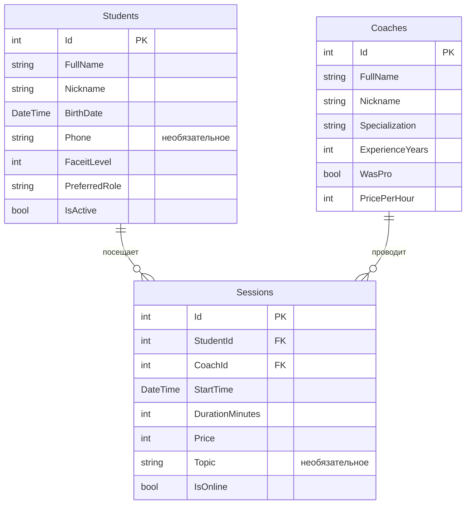

# Plant Academy
Приложение для учёта учеников, тренеров и занятий в киберспортивной академии по CS2.

## Автор
Навасардян Марк, группа РПО 24/1

## О проекте
- **Тема:** школа или секция
- **Заведение:** киберспортивная академия Plant Academy

Plant Academy — академия по CS2, куда приходят те, кто устал быть зомби на Faceit, а уходят игроки, ставшие чем-то большим, чем «+W-монстр». Здесь не учат зажимать кнопки: тренеры с опытом профессиональной сцены разбирают с учениками тактику, позиции и демки, потому что разница между игроками — в понимании игры. Выпускники академии выходят минимум на уровень tier 3. Приложением пользуются администратор и тренеры: записывают учеников, назначают занятия и следят за тем, как растёт уровень каждого игрока.

## Схема базы

## Таблицы

### Students
Ученики академии: кто они, как их зовут в игре и на каком они уровне.

| Поле | Тип | Обязательное | Описание |
|---|---|---|---|
| Id | int | да | первичный ключ |
| FullName | string | да | фамилия и имя ученика |
| Nickname | string | да | игровой ник |
| BirthDate | DateTime | да | дата рождения |
| Phone | string | нет | телефон для связи |
| FaceitLevel | int | да | текущий уровень на Faceit, от 1 до 10 |
| PreferredRole | string | да | роль в команде: entry, AWP, support, lurker, IGL |
| IsActive | bool | да | занимается ли ученик сейчас |

### Coaches
Тренеры академии и их специализация.

| Поле | Тип | Обязательное | Описание |
|---|---|---|---|
| Id | int | да | первичный ключ |
| FullName | string | да | фамилия и имя тренера |
| Nickname | string | да | игровой ник |
| Specialization | string | да | на чём специализируется: аим, тактика, роль IGL, разбор демок |
| ExperienceYears | int | да | стаж тренерской работы в годах |
| WasPro | bool | да | играл ли тренер на профессиональной сцене |
| PricePerHour | int | да | стоимость часа занятия в рублях |

### Sessions
Занятия: какой ученик, у какого тренера, когда и чем занимался.

| Поле | Тип | Обязательное | Описание |
|---|---|---|---|
| Id | int | да | первичный ключ |
| StudentId | int | да | внешний ключ на ученика (Students) |
| CoachId | int | да | внешний ключ на тренера (Coaches) |
| StartTime | DateTime | да | дата и время начала занятия |
| DurationMinutes | int | да | длительность в минутах |
| Price | int | да | стоимость занятия в рублях |
| Topic | string | нет | тема: разбор демки, аим, раскидка гранат, тактика |
| IsOnline | bool | да | занятие онлайн или в академии |

## Связи
Таблицы `Students` и `Coaches` связаны через таблицу `Sessions`. В ней два внешних ключа: `StudentId` ссылается на ученика, `CoachId` — на тренера. Один ученик может заниматься у нескольких тренеров (например, аим у одного, тактику у другого), а у одного тренера много учеников. Поэтому между учениками и тренерами получается связь «многие ко многим», а каждая запись в `Sessions` — это одно конкретное занятие.
